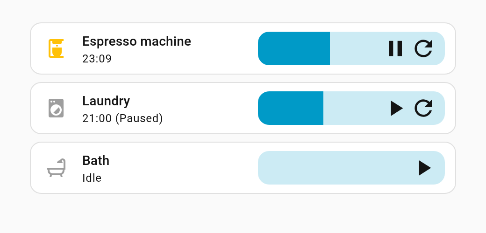

# Timer Progress Feature

A tile card feature for Home Assistant `timer` entities: a progress bar that
drains as the timer runs, with pause/resume and reset buttons on it. Drag the
bar of a running timer to change its remaining time.

<picture>
  <source media="(prefers-color-scheme: dark)" srcset="docs/screenshot-dark.png">
  
</picture>

## Install

Add this repository to the Marketplace (**Settings** > **Marketplace** >
**Add from link**) as a **Dashboard** repository, then install it. The
Marketplace registers the dashboard resource for you.

## Usage

Add the feature to a tile card for a timer. It fits best inline, which keeps
the tile to a single row:

```yaml
type: tile
entity: timer.espresso_machine_shutdown_timer
features_position: inline
features:
  - type: custom:timer-progress
    color: primary
    icon_color: black
```

| Option         | Default            | Description                                                                               |
| -------------- | ------------------ | ----------------------------------------------------------------------------------------- |
| `reset_action` | `cancel`           | `cancel` returns the timer to idle, `restart` starts it over from its full duration, `none` hides the reset button. |
| `color`        | tile's state color | Bar color: an HA color name (`blue`, `primary`, …) or any CSS color.                      |
| `icon_color`   | primary text color | Button icon color, same format as `color`. A fixed color such as `black` ignores dark mode. |

## Behavior

- **Pause/resume:** the first button pauses a running timer and starts or
  resumes it otherwise.
- **Reset:** hidden while the timer is idle.
- **Drag:** only on a running timer, since `timer.change` rejects paused ones.
  The new time is sent once, on release. The bar stops at the timer's full
  duration, which `timer.change` can't exceed; dragging it empty calls
  `timer.finish`.

Requires Home Assistant 2025.6 or later.
